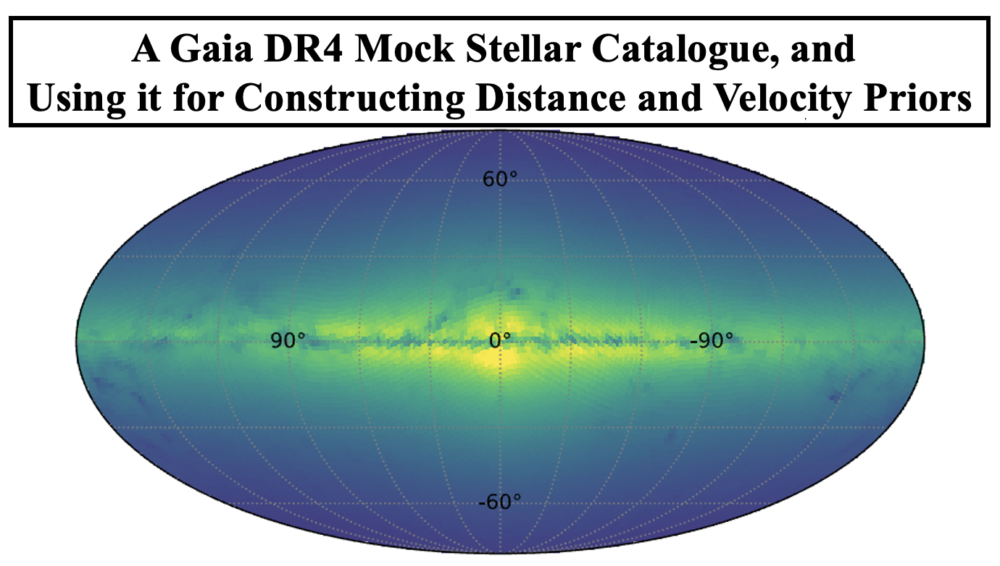

 
 

This repository provides certain data products based on the paper **Malhan & Bailer-Jones (2027)**, arXiv: 

 
 
<b><ins>Gaia DR4 Mock Stellar Catalogue (publicly available)</ins></b>

- `_read_me.pdf`: Provides the description of this catalogue

- `p01m_to_download_GDR4mock_from_GAVO.py`: Lets you bulk download the catalogue from GAVO [https://dc.g-vo.org/browse/dr4mock/q] [http://dc.g-vo.org/dr4mock/q/dl/static/]. 

- `zFig01.png`: this corresponds to Fig. 3 of the above mentioned paper

 
 
<b><ins>Priors (publicly available)</ins></b>

- `zFile04b_priors_edsd_ggd.fits`: This file provides two types of distance priors, based on **EDSD** and **GGD** models, both constrained using the `Gaia DR4 mock stellar catalogue`. This file contains the following columns.
   
`healpix_id`                         : healpixel id

`glon`, `glat`                       : Galactic longitude and latitude corresponding to the healpixel

`Gmag_GDR4_q0.998`                   : Stars brighter than G<`Gmag_GDR4_q0.998` are used to fit the models

`edsd_L`                             : fitted $L$ parameter of the EDSD model 

`r_edsd_50`, `r_edsd_16`, `r_edsd_84`: 50, 16, and 84 quantiles of the fitted EDSD model

`ggd_alpha`, `ggd_beta`, `ggd_L`     : fitted ($\alpha, \beta, L$) parameters of the GGD model

`r_ggd_50`, `r_ggd_16`, `r_ggd_84`   : 50, 16, and 84 quantiles of the fitted GGD model
